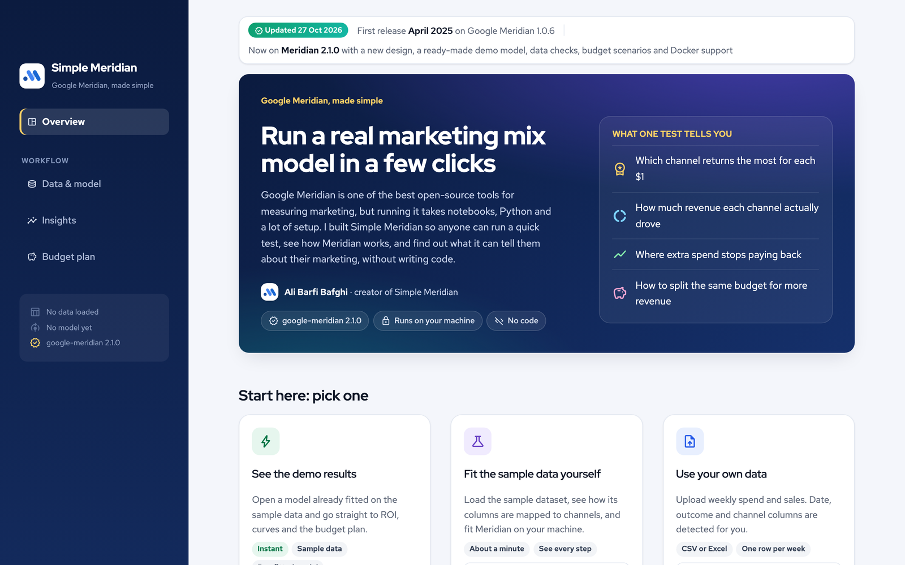
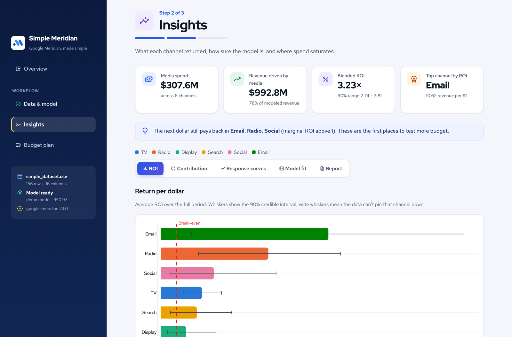
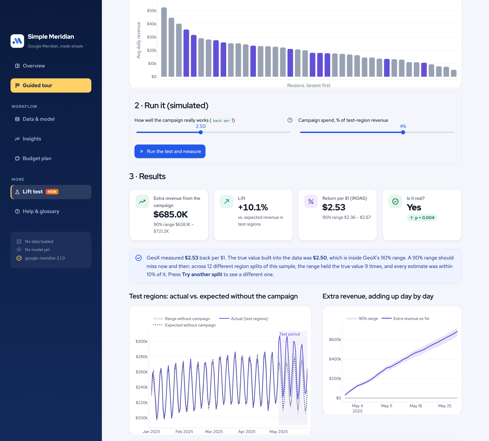

<div align="center">


# Simple Meridian

**A no-code app for Google Meridian, the open-source marketing mix model.**
Upload weekly spend and sales, and get channel ROI, response curves and a budget plan without writing code.

[](https://pypi.org/project/google-meridian/)
[](https://www.python.org/)
[](https://streamlit.io/)
[](#run-with-docker)
[](LICENSE)

**Updated 27 Oct 2026.** First released April 2025 on Meridian 1.0.6, now on Meridian 2.1.0. See the [version history](#version-history).



</div>

---

## What it does

Marketing mix modeling (MMM) estimates how much revenue each channel produced, using only weekly totals. No user tracking or cookies are involved. [Meridian](https://github.com/google/meridian) is Google's Bayesian MMM. It handles carryover (an ad keeps working for weeks after it runs) and saturation (each extra dollar buys less than the one before). Running it normally takes a notebook and a fair amount of Python.

I built Simple Meridian so anyone can run a quick test, see how Meridian works, and find out what it can tell them about their marketing, without writing code. The app handles data loading, sampling, analysis and reports through a point-and-click interface.

| Step | What you do | What you get |
|---|---|---|
| **1 · Data & model** | Upload a CSV or Excel file. Confirm the date, outcome and channel columns (they are detected automatically). Pick a sampling preset. | A fitted Meridian model, fit quality (R², MAPE, R-hat), and a model file you can download and reopen later. |
| **2 · Insights** | Look through the tabs. | ROI with 90% credible intervals, average vs. marginal ROI, baseline vs. media revenue, share of spend vs. share of revenue, response curves, actual vs. predicted, and Meridian's HTML report. |
| **3 · Budget plan** | Pick a period, a per-channel limit (±30% by default), and keep the budget or set a new total. | The spend split with the most incremental revenue, where it lands on each response curve, and CSV, Excel and HTML exports. |
| **GeoX (Lift test)** (new) | Design a geo experiment with [Meridian GeoX](https://developers.google.com/meridian/geox), or upload a test you already ran. | Test and control regions, the smallest lift the test can detect, the measured extra revenue and return per $1, and a one-click ROI prior for the next model fit. |

New to marketing measurement? Click **Take the 2-minute tour** on the home page. It walks through the demo page by page and highlights what to click. **Help & glossary** in the sidebar explains every term.

Everything runs on your machine. Your data is not sent anywhere.

<table>
  <tr>
    <td width="50%"></td>
    <td width="50%"></td>
  </tr>
  <tr>
    <td align="center"><sub>Insights: ROI by channel, with uncertainty</sub></td>
    <td align="center"><sub>Budget plan: actual vs. optimized budget mix</sub></td>
  </tr>
</table>

## Two editions

| | Live demo | Local edition |
|---|---|---|
| What it is | A recorded walkthrough of the demo company, with an auto-playing guided tour | The full app: your own data, model fits, budget plans, GeoX lift tests |
| Where it runs | In the browser, hosted free on GitHub Pages (`docs/` folder) | On your Mac or Windows PC, in Docker |
| Needs | Nothing | Docker Desktop and about 4 GB of free RAM |
| Your data | No uploads; the page sends no data and sets no cookies | Stays on your computer |

## Quick start

### Local edition on macOS or Windows (Docker)

1. Install [Docker Desktop](https://www.docker.com/products/docker-desktop/) and start it. On Windows, use the WSL 2 backend (the default).
2. Download this repository (green **Code** button → **Download ZIP**, or `git clone https://github.com/alibb007/Simple-Meridian.git`).
3. Start the app:
   - **macOS / Linux:** open Terminal in the folder and run `./start.sh`
   - **Windows:** double-click `start.bat`
4. Your browser opens <http://localhost:8501>. Stop the app with `docker compose down`.

The scripts run `docker compose up --build`, so you can also use that directly. The app listens on `127.0.0.1` only, so other computers on your network can't reach it. The first build downloads Meridian, TensorFlow and JAX and takes a few minutes; the image is about 2.9 GB on Apple silicon and 3.7 GB on Intel/AMD (Windows).

Tested so far: the image builds and runs natively on Apple silicon (arm64). The Intel/AMD (amd64) image used by Windows and Intel Macs builds, opens the demo model and fits the sample data (R² 0.965, same as native) when emulated on Apple silicon. `start.ps1`/`start.bat` have not yet been run on a real Windows machine.

### Live demo

The `docs/` folder is a static site with the demo results, the motion graphic and the auto-playing tour. To publish it for free, turn on **Settings → Pages → Deploy from a branch → `main` / `docs`** in the GitHub repository. It will be served at `https://alibb007.github.io/Simple-Meridian/`. GitHub Pages is free for public repositories, with a 1 GB site limit and a soft limit of 100 GB of traffic per month; the demo is about 170 KB.

### Run with Python

Python 3.11 or newer is required. 3.12 is what the app is tested on.

```bash
git clone https://github.com/alibb007/Simple-Meridian.git
cd Simple-Meridian
python3.12 -m venv .venv
source .venv/bin/activate        # Windows: .venv\Scripts\activate
pip install -r requirements.txt
streamlit run app.py
```

The home page gives you three ways in:

- **Take the 2-minute tour**: a guided walkthrough of the demo for people who have never used an MMM.
- **Open the demo**: a model already fitted on the sample data. Results open in a few seconds.
- **Use my data**: upload a CSV or Excel file. You can also load the sample data and fit it yourself in about a minute.

## GeoX (Lift test)

A marketing mix model learns from history, so two channels that always moved together can fool it. A lift test is an experiment: a campaign runs in some regions and stays off in similar ones, and the gap is what the campaign caused. The **GeoX (Lift test)** page uses [Meridian GeoX](https://github.com/google/meridian-geox) 1.0.1 for both halves:

1. **Plan**: GeoX searches thousands of region splits and picks test and control groups that tracked each other before the test. It also reports the smallest lift the test can detect and a suggested budget.
2. **Measure**: after the test, GeoX predicts what the test regions would have done without the campaign (Time-Based Regression) and reports the extra revenue, the lift and the return per $1 (iROAS), each with a 90% range.
3. **Calibrate**: one click turns that return per $1 into an ROI prior for the matching channel. The next fit in step 1 uses it.

The sample test uses 40 made-up regions. You choose the true return per $1 hidden in the data and check whether GeoX finds it. With the default settings it estimates $2.53 for a true $2.50 (90% range $2.36 to $2.67). Across 12 different region splits, the 90% range held the true value 9 times and every estimate was within 10% of it. Feeding that $2.53 ± 0.25 into the sample model as TV's prior narrowed TV's ROI range from 1.42–3.86 to 2.23–2.95 (Quick check preset).



For your own test, upload daily data with `date`, `location`, `conversions` and `spend` columns, pick the test regions and dates, and press **Measure the lift**.

## Data format

One row per week, one column per measure:

| week | tv_spend | tv_impressions | search_spend | search_clicks | price_index | sales |
|---|---|---|---|---|---|---|
| 2024-01-07 | 81200 | 9100000 | 22400 | 41000 | 1.02 | 612400 |
| 2024-01-14 | 77950 | 8700000 | 23100 | 43900 | 1.02 | 598100 |

- **Dates**: weekly, evenly spaced, with no gaps or repeats. Any common date format works. Two to three years of data gives much more stable estimates than one.
- **Outcome**: revenue, or conversions. For conversions you can add a revenue-per-conversion column so ROI comes out in currency.
- **Channels**: spend for every paid channel, plus impressions, clicks or GRPs for the same channel. Columns named `<channel>_spend` and `<channel>_impression(s)` are paired automatically. If a channel only has spend, use the spend column for both.
- **Controls** (optional): price, promotions, seasonality, competitor activity, market trends. Anything that moves sales but is not paid media.

The app checks the data before fitting. Gaps, repeated dates, empty cells, negative spend and constant controls are reported in plain language.

A sample file is in [`data/simple_dataset.csv`](data/simple_dataset.csv).

## Sampling presets

Meridian estimates the model with MCMC sampling. More samples take longer and give tighter, more reliable estimates.

| Preset | Chains | Adapt / burn-in / keep | Typical time* | Use it for |
|---|---|---|---|---|
| Quick check | 2 | 300 / 300 / 250 | ~30 s | Checking your setup |
| Standard | 4 | 500 / 500 / 500 | ~35 s | Numbers you plan to act on |
| Thorough | 4 | 1000 / 1000 / 1000 | longer (not benchmarked) | Final reads, borderline convergence |

\* Measured with the sample data (six channels, 156 weeks) on an Apple M-series laptop: 26 s and 35 s. Most of that is a one-off JAX compile, so Standard costs little more than Quick check. Time grows with the number of channels and weeks. Meridian's JAX backend fitted the sample about 2.8× faster than its TensorFlow backend (26 s vs. 74 s), so the app uses JAX.

The app uses Meridian's default carryover window (8 weeks) and a fixed random seed, so the same data and preset always give the same result.

If max R-hat on the **Model fit** tab is above 1.2, the chains have not agreed yet. Fit again with a longer preset before trusting the numbers.

## Saving and reopening models

**Download model file** saves the model in Meridian's protobuf format (`.binpb`, via `meridian.schema.serde`). Open it again from step 1, 2 or 3 to skip re-fitting. Open it with the same `google-meridian` version that saved it.

`.pkl` files from older versions of this app (Meridian 1.0.x) can still be opened, but they usually fail under Meridian 2.x. Re-fit those models. Pickle files can run code when opened, so only open ones you made yourself.

## Project layout

```
app.py                         entry point: page setup, sidebar, routing
app_pages/
  home.py                      overview page
  step1_upload_and_run.py      upload, column mapping, validation, fitting
  step2_insights.py            ROI, contribution, response curves, fit, report
  step3_optimization.py        budget optimizer and exports
  lift_test.py                 Meridian GeoX: design, measure, use as prior
  report.py                    Meridian's own report charts, each explained
  help.py                      glossary and FAQ
  legal.py                     privacy, terms, licenses
  common.py                    shared state, caching, model upload/download
utils/
  mmm.py                       all Meridian calls; returns plain pandas tables
  geox.py                      all GeoX calls, plus the sample geo data
  tour.py                      the guided tour
  report_charts.py             plain-words text for every Meridian report chart
  charts.py                    Plotly charts
  ui.py                        theme, CSS, sidebar navigation, small components
static/motion/how-it-works.html  16-second motion graphic on the home page
docs/                          static live demo for GitHub Pages
start.sh / start.bat / start.ps1  one-step start on macOS, Linux and Windows
docker-compose.yml             local edition, bound to 127.0.0.1
scripts/build_demo.py          refits the demo model and precomputes its charts
tests/test_pages.py            renders every page and tour step headlessly
.streamlit/config.toml         theme
data/simple_dataset.csv        sample data
data/sample_model.binpb        demo model (Standard preset)
data/demo/                     precomputed demo results, so the demo opens instantly
```

After upgrading `google-meridian`, run `python scripts/build_demo.py --refit` so the demo model matches the new version.

`utils/mmm.py` is the only file that imports Meridian. If a future Meridian release changes its API, that is the one file to update.

## Version history

**27 Oct 2026, Meridian 2.1.0**

- Upgraded from `google-meridian` 1.0.6 to **2.1.0** (TensorFlow 2.21, JAX backend). Ported the app to the 2.x API: `DataFrameDataLoader`, `start_date`/`end_date` in the optimizer, and the new report signatures.
- Added a guided tour for people new to MMM, and a Help & glossary page.
- Added **lift tests with Meridian GeoX 1.0.1**: design a geo experiment, measure it, and use the result as an ROI prior.
- Added a demo: a pre-fitted model with precomputed charts, so you can see the results without fitting anything.
- New home page: what the app is for, the demo's real results, a 16-second motion graphic, and three pictures of how Meridian reasons.
- Guided tour spotlights each part it explains and dims the rest; its card sits right above that part. It has 26 steps: step 1 section by section, then every chart from Meridian's own report.
- New **Meridian charts** page: the 12 model charts and 4 budget-plan charts from Meridian's HTML report, drawn by Meridian, each with "what it shows" and "how to read it" in plain words.
- Step 1 now runs in order (data, time and outcome, channels, controls, fit), with channel cards you can rename, re-map, add and remove.
- Budget plan period: latest 52 weeks, last full calendar year, full history, or custom dates from an in-app calendar.
- Privacy & terms page, SECURITY.md and THIRD_PARTY_NOTICES.md; pickle model files are off by default; uploads capped at 50 MB.
- Local edition for macOS and Windows (`start.sh`, `start.bat`, `docker-compose.yml`) and a static live demo in `docs/`.
- Faster: Meridian loads in the background instead of on the first page load (page import went from 7.1 s to 0.5 s), optimizer results are cached, and the JAX backend is pinned.
- Models are saved as `.binpb` with Meridian's serializer, replacing the deprecated pickle format.
- Redesigned the interface: a home page with three starting points, a navigation sidebar, icons, pill tabs, and one color per channel across every chart. Step 1 now has numbered sections and a "Ready to fit" checklist; data is checked before fitting.
- Budget plan supports a new total budget as well as the same budget, with per-channel limits.
- Docker image went from 3.82 GB to 2.62 GB by dropping C++ headers, test suites, libclang and debug symbols. It runs on Python 3.12 as a non-root user, with a health check.

**April 2025, Meridian 1.0.6**

- First release: upload data, map columns, fit Meridian, view its charts, and run the budget optimizer.

## Troubleshooting

- **The fit is slow.** Start with **Quick check**. Fewer channels and fewer weeks also help. Docker Desktop on macOS gets fewer CPUs than the host by default; raise the limit under Settings → Resources.
- **"Dates are not evenly spaced."** Meridian needs one row per period with no gaps. Fill missing weeks with zeros for spend and the real outcome value.
- **ROI intervals are very wide.** The data cannot separate that channel from the others, often because its spend barely changes or moves in step with another channel. Longer history or more spend variation helps.
- **Port 8501 is taken.** Use `docker run -p 8502:8501 simple-meridian` and open <http://localhost:8502>.

## Privacy, security and licenses

- Uploaded files are processed in memory on the machine running the app and are not sent anywhere. Upload aggregate weekly totals only, never personal data.
- Results are statistical estimates, not financial advice. The software is provided "as is" under the MIT License.
- Security measures and how to report a problem: [SECURITY.md](SECURITY.md). Open-source components and their licenses: [THIRD_PARTY_NOTICES.md](THIRD_PARTY_NOTICES.md). The app's **Privacy & terms** page has the same summary.
- Learn more about the libraries this app runs on: [Google Meridian](https://developers.google.com/meridian) · [Meridian GeoX](https://developers.google.com/meridian/geox) · [Meridian on GitHub](https://github.com/google/meridian).

## Credits

Built by **Ali Barfi Bafghi** · [GitHub](https://github.com/alibb007) · [LinkedIn](https://www.linkedin.com/in/alibarfibafghi/) · [Email](mailto:ali.barfib@gmail.com)

Simple Meridian is an independent project. It uses the open-source [Google Meridian](https://github.com/google/meridian) library (Apache 2.0) and is not affiliated with or endorsed by Google. Meridian is a trademark of Google LLC.

Released under the [MIT License](LICENSE).
