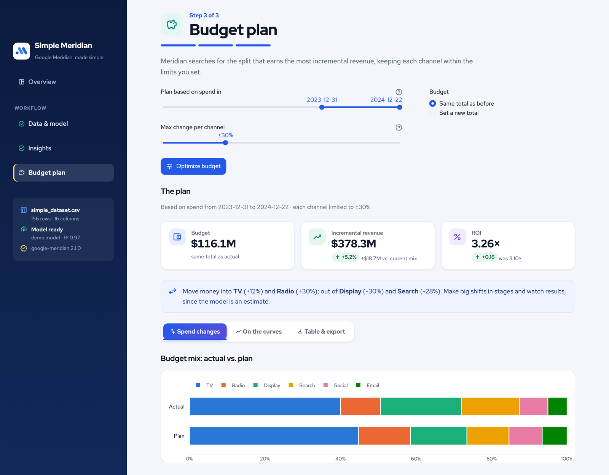
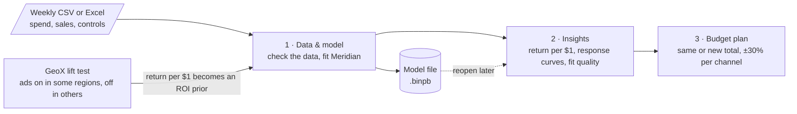

<div align="center">


# Simple Meridian

**Google Meridian, in plain words.** A no-code app for Google's open-source marketing mix model.<br>
Upload weekly spend and sales, and see which ads bring in your sales and where the next dollar should go.

[](https://alibb007.github.io/simple-meridian-demo/)
[](#quick-start)

[](https://pypi.org/project/google-meridian/)
[](https://github.com/google/meridian-geox)
[](https://www.python.org/)
[](https://streamlit.io/)
[](LICENSE)

**Updated 28 Oct 2026** · [What's new](#whats-new) · [Quick start](#quick-start) · [How it works](#how-it-works) · [GeoX lift tests](#geox-lift-tests) · [Project layout](#project-layout) · [Changelog](CHANGELOG.md)



</div>

---

## What it answers

Marketing mix modeling (MMM) works out how much revenue each ad channel produced, using only weekly totals, with no user tracking or cookies. [Meridian](https://github.com/google/meridian) is Google's Bayesian MMM. It handles carryover (an ad keeps working for weeks after it runs) and saturation (each extra dollar buys less than the one before). Running it normally takes a notebook and a fair amount of Python. Simple Meridian puts it behind buttons, so you can try it on your own data and see what it can tell you.

| Question | Where the app answers it | On the sample data |
|---|---|---|
| What did each $1 bring back? | **2 · Insights**: return per $1 by channel, with a 90% range | Email $10.62, Display $1.61 |
| Where is extra money wasted? | **2 · Insights**: response curves and the return on the *next* $1 | Display's next $1 brings back $0.78 |
| How should we split the budget? | **3 · Budget plan**: same total, a better split | +5.2% sales from ads, same budget |
| Can a real test prove it? | **GeoX (Lift test)**: ads on in some regions, off in others | Found $2.53 per $1 for a hidden true $2.50 |

<table>
  <tr>
    <td width="50%"></td>
    <td width="50%"></td>
  </tr>
  <tr>
    <td align="center"><sub>Insights: return per $1 by channel, with uncertainty</sub></td>
    <td align="center"><sub>Budget plan: today's split next to the plan</sub></td>
  </tr>
</table>

New to marketing measurement? Open the [guided tour](https://alibb007.github.io/simple-meridian-demo/) first. It starts with a short animated story, then walks through the app on a made-up shop, part by part, in your browser. Inside the app, **Help & glossary** explains every term.

## What's new

The first release came out in April 2025. The 27–28 Oct 2026 update rebuilt most of it:

| | April 2025 (first release) | October 2026 (now) |
|---|---|---|
| Meridian | 1.0.6 | **2.1.0**, on the faster JAX backend |
| Pages | Upload, fit, charts, budget optimizer | Same steps redesigned, plus **GeoX lift tests**, a **Meridian charts** page with every chart explained, and **Help & glossary** |
| Learning it | Read the README | A **guided tour website** with a seven-scene story, no install |
| Trying it | Upload a file (a sample CSV sits in `data/`) | **Open demo results** in a few seconds, or press **Use the sample** and fit it in about a minute |
| Starting it | `docker build` and `docker run` by hand | `./start.sh` on macOS and Linux, double-click `start.bat` on Windows |
| Saved models | Python pickle files | `.binpb`, Meridian's own format |
| Privacy | Port open to the network (`-p 8501:8501`) | Runs on `127.0.0.1` only, uploads capped at 50 MB, a Privacy & terms page and [SECURITY.md](SECURITY.md) |

Latest, 28 Oct 2026: the tour's story was rewritten, the files were reorganized (images in `assets/`, build scripts in `scripts/`), and this README is new. Every change is in the [changelog](CHANGELOG.md).

## Quick start

Everything runs on your computer. Your data is not sent anywhere.

<details open>
<summary><b>macOS or Linux</b> (Docker)</summary>

1. Install [Docker Desktop](https://www.docker.com/products/docker-desktop/) and start it.
2. Download this repository: green **Code** button → **Download ZIP**, or `git clone https://github.com/alibb007/Simple-Meridian.git`.
3. Open Terminal in the folder and run:

   ```bash
   ./start.sh
   ```

4. Your browser opens <http://localhost:8501>. Stop the app with `docker compose down`.

</details>

<details>
<summary><b>Windows 10 or 11</b> (Docker)</summary>

1. Install [Docker Desktop](https://www.docker.com/products/docker-desktop/) with the WSL 2 backend (the default) and start it.
2. Download this repository: green **Code** button → **Download ZIP**, then unzip it.
3. Double-click `start.bat` in the folder. It runs `start.ps1` for you.
4. Your browser opens <http://localhost:8501>. Stop the app with `docker compose down`.

`start.bat` and `start.ps1` have not yet been run on a real Windows machine. The Intel/AMD image they use builds, opens the demo model and fits the sample data (R² 0.965, the same as native) when emulated on Apple silicon.

</details>

<details>
<summary><b>Python</b> (no Docker)</summary>

Python 3.11 or newer; the app is tested on 3.12.

```bash
git clone https://github.com/alibb007/Simple-Meridian.git
cd Simple-Meridian
python3.12 -m venv .venv
source .venv/bin/activate        # Windows: .venv\Scripts\activate
pip install -r requirements.txt
streamlit run app.py
```

</details>

The first Docker build downloads Meridian, TensorFlow and JAX and takes a few minutes. The image is about 2.9 GB on Apple silicon and 3.7 GB on Intel/AMD. The app listens on `127.0.0.1` only, so other computers on your network can't reach it.

The app opens on the upload screen, with three ways in:

- **Upload your file**: a CSV or Excel file with one row per week.
- **Use the sample**: load the sample data and fit it yourself in about a minute.
- **Open demo results**: a model already fitted on the sample data, open in a few seconds.

## How it works



| Step | What you do | What you get |
|---|---|---|
| **1 · Data & model** | Upload a CSV or Excel file. Confirm the date, outcome and channel columns (detected automatically). Pick a sampling preset. | A fitted Meridian model, fit quality (R², MAPE, R-hat), and a model file you can download and reopen later. |
| **2 · Insights** | Look through the tabs. | Return per $1 with 90% ranges, average vs. next-$1 return, baseline vs. media revenue, share of spend vs. share of revenue, response curves, actual vs. predicted, and Meridian's own report. |
| **3 · Budget plan** | Pick a period, a per-channel limit (±30% by default), and keep the budget or set a new total. | The split with the most extra revenue, where each channel lands on its response curve, and CSV, Excel and HTML exports. |
| **GeoX (Lift test)** | Design a geo experiment with [Meridian GeoX](https://developers.google.com/meridian/geox), or upload one you already ran. | Test and control regions, the smallest lift the test can detect, the measured extra revenue and return per $1, and a one-click ROI prior for the next fit. |

`utils/mmm.py` is the only file that imports Meridian, and `utils/geox.py` the only one that imports GeoX. If a future release changes the API, those are the files to update.

## GeoX lift tests

A marketing mix model learns from history, so two channels that always moved together can fool it. A lift test is an experiment: a campaign runs in some regions and stays off in similar ones, and the gap is what the campaign caused. The **GeoX (Lift test)** page uses [Meridian GeoX](https://github.com/google/meridian-geox) 1.0.1 in three steps:

1. **Plan**: GeoX searches thousands of region splits and picks test and control groups that tracked each other before the test. It also reports the smallest lift the test can detect and a suggested budget.
2. **Measure**: after the test, GeoX predicts what the test regions would have done without the campaign (Time-Based Regression) and reports the extra revenue, the lift and the return per $1 (iROAS), each with a 90% range.
3. **Calibrate**: one click turns that return per $1 into an ROI prior for the matching channel. The next fit in step 1 uses it.

The sample test uses 40 made-up regions, with a true return per $1 you choose hidden in the data. With the default settings GeoX estimates $2.53 for a true $2.50 (90% range $2.36 to $2.67). Across 12 different region splits, the 90% range held the true value 9 times and every estimate was within 10% of it. Feeding that $2.53 ± 0.25 into the sample model as TV's prior narrowed TV's ROI range from 1.42–3.86 to 2.23–2.95 (Quick check preset).


For your own test, upload daily data with `date`, `location`, `conversions` and `spend` columns, pick the test regions and dates, and press **Measure the lift**.

## Reference

<details>
<summary><b>Data format</b>: one row per week, one column per measure</summary>

| week | tv_spend | tv_impressions | search_spend | search_clicks | price_index | sales |
|---|---|---|---|---|---|---|
| 2024-01-07 | 81200 | 9100000 | 22400 | 41000 | 1.02 | 612400 |
| 2024-01-14 | 77950 | 8700000 | 23100 | 43900 | 1.02 | 598100 |

- **Dates**: weekly, evenly spaced, with no gaps or repeats. Any common date format works. Two to three years of data gives much more stable estimates than one.
- **Outcome**: revenue, or conversions. For conversions you can add a revenue-per-conversion column so ROI comes out in currency.
- **Channels**: spend for every paid channel, plus impressions, clicks or GRPs for the same channel. Columns named `<channel>_spend` and `<channel>_impression(s)` are paired automatically. If a channel only has spend, use the spend column for both.
- **Controls** (optional): price, promotions, seasonality, competitor activity, market trends. Anything that moves sales but is not paid media.

The app checks the data before fitting and reports gaps, repeated dates, empty cells, negative spend and constant controls in plain language. A sample file is in [`data/simple_dataset.csv`](data/simple_dataset.csv).

</details>

<details>
<summary><b>Sampling presets</b>: Quick check, Standard, Thorough</summary>

Meridian estimates the model with MCMC sampling. More samples take longer and give tighter, more reliable estimates.

| Preset | Chains | Adapt / burn-in / keep | Typical time* | Use it for |
|---|---|---|---|---|
| Quick check | 2 | 300 / 300 / 250 | ~30 s | Checking your setup |
| Standard | 4 | 500 / 500 / 500 | ~35 s | Numbers you plan to act on |
| Thorough | 4 | 1000 / 1000 / 1000 | longer (not benchmarked) | Final reads, borderline convergence |

\* Measured with the sample data (six channels, 156 weeks) on an Apple M-series laptop: 26 s and 35 s. Most of that is a one-off JAX compile, so Standard costs little more than Quick check. Time grows with the number of channels and weeks. Meridian's JAX backend fitted the sample about 2.8× faster than its TensorFlow backend (26 s vs. 74 s), so the app uses JAX.

The app uses Meridian's default carryover window (8 weeks) and a fixed random seed, so the same data and preset always give the same result. If max R-hat on the **Model fit** tab is above 1.2, the chains have not agreed yet; fit again with a longer preset before trusting the numbers.

</details>

<details>
<summary><b>Saving and reopening models</b></summary>

**Download model file** saves the model in Meridian's protobuf format (`.binpb`, via `meridian.schema.serde`). Open it again from step 1, 2 or 3 to skip re-fitting. Open it with the same `google-meridian` version that saved it.

`.pkl` files from older versions of this app (Meridian 1.0.x) can still be opened, but they usually fail under Meridian 2.x, so re-fit those models. Pickle files can run code when opened, so only open ones you made yourself.

</details>

<details>
<summary><b>Troubleshooting</b></summary>

- **The fit is slow.** Start with **Quick check**. Fewer channels and fewer weeks also help. Docker Desktop on macOS gets fewer CPUs than the host by default; raise the limit under Settings → Resources.
- **"Dates are not evenly spaced."** Meridian needs one row per period with no gaps. Fill missing weeks with zeros for spend and the real outcome value.
- **Return ranges are very wide.** The data cannot separate that channel from the others, often because its spend barely changes or moves in step with another channel. Longer history or more spend variation helps.
- **Port 8501 is taken.** Run `docker run -p 8502:8501 simple-meridian` and open <http://localhost:8502>.

</details>

## Project layout

```
app.py                    entry point: page setup, sidebar, routing
app_pages/                one file per page
  step1_upload_and_run.py   upload, column mapping, data checks, fitting
  step2_insights.py         return per $1, contribution, response curves, fit
  step3_optimization.py     budget plan and exports
  report.py                 Meridian's own report charts, each explained
  lift_test.py              Meridian GeoX: design, measure, use as a prior
  help.py · legal.py        glossary and FAQ · privacy, terms, licenses
  common.py                 shared state, caching, model upload and download
utils/                    the code behind the pages
  mmm.py                    every Meridian call; returns plain pandas tables
  geox.py                   every GeoX call, plus the sample geo data
  report_charts.py          plain-words text for each Meridian report chart
  charts.py · ui.py         Plotly charts · theme, CSS, sidebar, small components
data/                     sample data, the demo model and its precomputed results
assets/                   logo and photo the app shows; screenshots/ and readme/ for this page
docs/                     the guided tour website (published to GitHub Pages)
scripts/
  demo/                     build_demo.py (demo model and results), build_geox_demo.py
  site/                     build_site_data.py, tour_steps.py (tour text), stamp_assets.py, publish.sh
tests/                    test_pages.py renders every page headlessly; test_logic.py checks the data rules
start.sh · start.bat · start.ps1 · Dockerfile · docker-compose.yml   run it locally
```

<details>
<summary><b>Rebuilding the demo and the website</b></summary>

After upgrading `google-meridian`, refit the demo model so it matches the new version, then rebuild the website's data:

```bash
python scripts/demo/build_demo.py --refit
python scripts/demo/build_geox_demo.py
python scripts/site/build_site_data.py
python tests/test_logic.py
python tests/test_pages.py
```

`scripts/site/publish.sh` stamps the website's file links and copies `docs/` into a checkout of [simple-meridian-demo](https://github.com/alibb007/simple-meridian-demo), which GitHub Pages serves. It does not commit or push.

</details>

## Privacy, security and licenses

- Uploaded files are processed in memory on the machine running the app and are not sent anywhere. Upload weekly totals only, never personal data.
- Results are statistical estimates, not financial advice. The software is provided "as is" under the MIT License.
- Security measures and how to report a problem: [SECURITY.md](SECURITY.md). Open-source components and their licenses: [THIRD_PARTY_NOTICES.md](THIRD_PARTY_NOTICES.md). The app's **Privacy & terms** page has the same summary.
- The libraries underneath: [Google Meridian](https://developers.google.com/meridian) · [Meridian GeoX](https://developers.google.com/meridian/geox) · [Meridian on GitHub](https://github.com/google/meridian).

## Credits

Built by **Ali Barfi Bafghi** · [GitHub](https://github.com/alibb007) · [LinkedIn](https://www.linkedin.com/in/alibarfibafghi/) · [Email](mailto:ali.barfib@gmail.com)

Simple Meridian is an independent project. It uses the open-source [Google Meridian](https://github.com/google/meridian) library (Apache 2.0) and is not affiliated with or endorsed by Google. Meridian is a trademark of Google LLC.

Released under the [MIT License](LICENSE).
